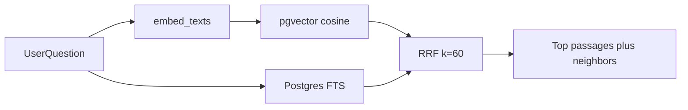

# Phase 5 — Hybrid retrieval

A user question becomes a short ranked list of source passages. Retrieval stays a library under [`backend/app/retrieval/`](backend/app/retrieval/). No chat route, agent tool, or reranker in this phase.

The [hybrid-retrieval cookbook](https://github.com/daveebbelaar/ai-cookbook/tree/main/knowledge/hybrid-retrieval) is the ranking reference, not a port. Its useful piece is Reciprocal Rank Fusion from [`4-rrf.py`](https://github.com/daveebbelaar/ai-cookbook/blob/main/knowledge/hybrid-retrieval/4-rrf.py): fuse **ranks**, not scores, with `k = 60`, pull `candidate_k = 50` from each retriever, then keep the top results. BM25 (`bm25s`) and the Cohere reranker stay out. Lexical search is the existing GIN index on `document_chunks.search_vector`. Semantic search is the existing HNSW index (`vector_cosine_ops`) on `document_chunks.embedding`. Both indexes already exist in [`backend/alembic/versions/389aefa10183_create_app_tables.py`](backend/alembic/versions/389aefa10183_create_app_tables.py). No new dependency and no migration.

## Ranking policy

- Embed the question with the same path as stored chunks: [`embed_texts`](backend/app/ingestion/embeddings.py) in [`backend/app/ingestion/embeddings.py`](backend/app/ingestion/embeddings.py), which truncates to 1536 dimensions and L2-normalizes. Cosine distance is valid only because both sides are normalized.
- Semantic query: chunks with `embedding_status = 'embedded'` and a non-null embedding, ordered by `embedding <=> :query_vector` (the `<=>` operator matches the HNSW opclass), limit 50.
- Lexical query: rank with `ts_rank_cd` against `search_vector`, limit 50. `plainto_tsquery` ANDs every word, which returns nothing for the paragraph-length questions in [`docs/client-brief.md`](docs/client-brief.md). Build an OR `tsquery` from the English lexemes of the question so shared terms such as "iPhone" or "Data Center" still match, the same job BM25 does in the cookbook.
- Fusion in pure Python: `score(id) = sum 1 / (60 + rank)`, sort descending. A chunk in both lists outranks a chunk in only one.
- Keep the top 8 fused hits. For each hit, load the chunk, filing columns from `source_documents` (ticker, company, filing type, filing date, fiscal year, accession number), and the previous and next chunk in the same document (`chunk_index ± 1`). Neighbors are context, not extra ranked hits.
- Empty question raises `ValueError`. Both lists empty returns `[]`.
- Database access reuses `database_engine()` from [`backend/app/database/documents.py`](backend/app/database/documents.py) and `sqlalchemy.text`, same style as `chunk_evidence`. Sync is enough here; the chat orchestrator can call it later.

## Modules

[`backend/app/retrieval/fusion.py`](backend/app/retrieval/fusion.py)

- `reciprocal_rank_fusion(rankings: list[list[UUID]], *, k: int = 60) -> list[tuple[UUID, float]]`
- Ranks are 1-based. Duplicate ids inside one list count once, at their first rank.

[`backend/app/retrieval/queries.py`](backend/app/retrieval/queries.py)

- `semantic_search(connection, query_embedding, limit) -> list[UUID]`
- `full_text_search(connection, query, limit) -> list[UUID]`
- `load_passages(connection, hits) -> list[RetrievedPassage]` including neighbor rows
- SQL lives in this module so tests can assert the statement text and bound parameters without a database.

[`backend/app/retrieval/retriever.py`](backend/app/retrieval/retriever.py)

- Frozen dataclasses `NeighborChunk` and `RetrievedPassage` (chunk id, document id, chunk index, content, metadata, filing fields, `rrf_score`, optional semantic and lexical ranks, neighbors).
- `retrieve(question: str, *, top_k: int = 8, candidate_k: int = 50) -> list[RetrievedPassage]`
- Owns the sequence: embed, both searches, fuse, slice, load.

## Tests

[`backend/tests/retrieval/test_fusion.py`](backend/tests/retrieval/test_fusion.py) — no database.

- A chunk ranked 1 in both lists scores `1/61 + 1/61` and beats a chunk ranked 1 in only one list.
- Order follows score. Equal scores keep a stable order.
- Empty rankings return `[]`. An id repeated inside one list is not double-counted.

[`backend/tests/retrieval/test_queries.py`](backend/tests/retrieval/test_queries.py) — mock the SQLAlchemy connection.

- Semantic SQL contains `<=>`, filters `embedding_status = 'embedded'`, and binds the vector and limit.
- Full-text SQL reads `search_vector`, uses `ts_rank_cd`, and binds the question and limit.
- `retrieve` with mocked search results calls fusion and asks `load_passages` only for the fused top ids, including neighbor indexes. Patch `embed_texts` so the unit suite never calls OpenRouter.

[`backend/tests/retrieval/test_brief_queries.py`](backend/tests/retrieval/test_brief_queries.py) — `@pytest.mark.integration`.

- Register the `integration` marker in [`backend/pyproject.toml`](backend/pyproject.toml). The fast suite stays `pytest -m "not integration"`.
- Skip when settings cannot load or the database has no embedded chunks.
- Run the ten questions from [`docs/client-brief.md`](docs/client-brief.md). For each question that names companies, assert the top passages include at least one of those tickers (`AAPL`, `AMZN`, `GOOGL`, `MSFT`, `NVDA`). Question 10 (do not infer that generative AI improved margins) only asserts a non-empty result whose text mentions margin or AI language; refusal is a later grounding concern, not a retrieval one.
- This is the scripted check. It needs the ingested corpus and OpenRouter, so it is not part of the default test run.

## Out of scope

- Cohere or local cross-encoder rerank, in-memory BM25, and FiQA NDCG from the cookbook.
- `search_filings` agent tools, citation validation, and wiring retrieval into `/chat/stream`. Those belong to the assistant and grounding phases.
